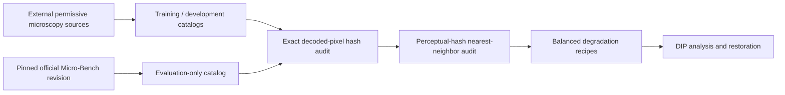

# Micro-Q-Instruct Phase 1

## A Syllabus-Centered Microscopy Degradation Benchmark

This repository implements Phase 1 of **Micro-Q-Instruct: A Degradation-Aware Vision-Language
Benchmark and Fine-Tuning Protocol for Microscopy Image Understanding**. Phase 1 is intentionally
designed as a complete classical Digital Image Processing study. Deep learning is not required to
produce its dataset, measurements, restorations, baseline, figures, or conclusions.

The central artifact is a reproducible paired benchmark:

```text
clean microscopy image
    + exact degradation recipe
    + degraded image
    + interpretable DIP fingerprint
    + paired fidelity/morphology measurements
    + matched classical restoration
```

These artifacts will later provide images and evidence-grounded targets for VLM instruction
tuning. The VLM is a downstream consumer rather than a substitute for Phase 1's image-processing
contribution.

> Verification status (2026-08-04): the strict 12,917-image pool audit and a 300-source,
> 2,723-recipe pilot completed successfully. The pilot validation passed with no errors and 99.85%
> PSNR severity monotonicity; the network-free test, lint, and strict typing checks also pass. The
> full Step 7 run remains intentionally unstarted.

## Scientific motivation

The main paper, [Micro-Bench](https://arxiv.org/abs/2407.01791), introduced a diverse microscopy
vision-language benchmark spanning light, fluorescence, and electron microscopy. It reported high
error rates even for coarse properties such as microscopy modality, and showed that specialized
fine-tuning may erase useful prior biomedical knowledge. Its official implementation is available
at [yeung-lab/Micro-Bench](https://github.com/yeung-lab/Micro-Bench).

[Q-Instruct](https://openaccess.thecvf.com/content/CVPR2024/html/Wu_Q-Instruct_Improving_Low-level_Visual_Abilities_for_Multi-modality_Foundation_Models_CVPR_2024_paper.html)
demonstrated the value of instruction tuning for low-level attributes such as clarity, brightness,
noise, and quality, but its images are primarily natural scenes. Micro-Q-Instruct targets the
largely unexplored intersection of low-level visual reasoning and microscopy.

Phase 1 asks:

1. Can interpretable DIP measurements identify microscopy degradation type and severity?
2. Are modality-aware signatures more reliable than treating all microscopy images identically?
3. Which classical restoration method recovers fidelity, edges, and biological morphology for
   each degradation?
4. Which corruptions are fundamentally non-invertible, and what evidence demonstrates that limit?

The later VLM phase will ask whether this structured evidence improves degradation reasoning while
preserving clean-image biomedical knowledge.

## Corrections to the initial proposal

Two scientifically important corrections are encoded in the design:

- **Photobleaching is signal decay, not clipping.** The implementation models retained
  fluorescence intensity. Clipping is a separate detector-saturation degradation.
- **Defocus direction is not labeled.** A symmetric single-image synthetic PSF cannot determine
  whether the focal plane lies above or below the specimen. The valid labels are degradation type,
  focus quality, PSF family, and severity.

Channel misregistration and photobleaching are gated to applicable fluorescence images. Chromatic
misregistration additionally requires meaningful multichannel data. Defocus is limited to optical
modalities in the example configuration, while scan/motion drift may also be used for electron
microscopy.

## Course-syllabus alignment

| Course chapter | Phase 1 implementation |
|---|---|
| Ch. 2: Digital Image Fundamentals | Resolution reduction, anti-aliasing ablation, bit-depth quantization, pixel/channel relationships, physical pixel metadata. |
| Ch. 3: Intensity and Spatial Filtering | Intensity decay, saturation, convolutional PSFs, gradient/Laplacian evidence, gamma and adaptive histogram enhancement. |
| Ch. 4: Frequency-Domain Filtering | Fourier energy ratios, spectral centroid, sinusoidal interference, paired notch-reject restoration. |
| Ch. 5: Restoration and Reconstruction | Poisson shot noise, Gaussian read noise, local Wiener filtering, PSF-based Wiener deconvolution. |
| Ch. 7: Wavelet and Other Transforms | Wavelet subband energy fingerprint and wavelet denoising comparison. |
| Ch. 8: Compression | Controlled JPEG quality, block-boundary measurement, and post-compression restoration baseline. |
| Ch. 9: Morphological Processing | Otsu proxy segmentation, opening/closing, Dice/IoU, area, and connected-component stability where reference masks exist. |

This mapping is operational: every row corresponds to implemented code, configuration, output
columns, or report artifacts.

## Strict two-pool policy

The current public Micro-Bench release is an evaluation benchmark. Training on its images—even
degraded copies with newly generated questions—would contaminate later clean Micro-Bench results.

The code enforces two data roles:



An official benchmark pool assigned to training or development fails immediately. Before
generation, images are compared with:

- SHA-256 over normalized decoded RGB pixels, independent of container metadata;
- 64-bit perceptual hashes;
- nearest-neighbor Hamming distance with a configurable rejection threshold.

Pool roles are also stored in every source, recipe, and analysis record. The classical fingerprint
baseline fits only on `training` records and evaluates only on `evaluation` records.
The pool audit also requires every source license to appear in an explicit configuration allowlist;
unknown licenses do not silently pass.

## Degradation model

The example configuration defines weak, medium, and strong levels for ten degradation families.
All parameters are versioned in YAML and copied into recipe manifests.

Catalogs declare 8- or 16-bit source precision. The image repository preserves 16-bit grayscale
and RGB PNG data through OpenCV and uses normalized float32 values internally; generated outputs
are written back at the declared precision. JPEG intentionally performs an 8-bit codec round trip,
so its effect on a 16-bit source includes the standard codec's precision reduction and must be
reported as such.

| Family | Model | Applicability |
|---|---|---|
| Sampling | Downsample followed by reconstruction to original dimensions, with configurable anti-aliasing | All modalities |
| Quantization | Uniform intensity quantization to a specified number of bits | All modalities |
| Poisson-Gaussian | Photon-count Poisson sampling plus additive Gaussian read noise | All modalities |
| Defocus | Normalized disk point-spread function | Light and fluorescence |
| Motion/scan drift | Normalized linear PSF with length and angle | All modalities |
| Periodic interference | Additive oriented sinusoid with controlled spatial frequency and amplitude | All modalities |
| JPEG | In-memory lossy encode/decode at controlled quality and chroma subsampling | All modalities |
| Photobleaching | Retained fluorescence signal above background | Fluorescence |
| Chromatic misregistration | Opposing subpixel channel shifts normalized by image size | Multichannel fluorescence |
| Saturation | Gain and black-level transform followed by detector-range clipping | All modalities |

The default planner creates a balanced incomplete factorial design. With nine variants per clean
image, it selects three applicable degradation families and includes all three severity levels for
each family. This enables within-image monotonicity checks without materializing every possible
combination. Clean controls and mixed corruptions are selected deterministically from configured
fractions. The example pool limits select 1,000 training, 250 development, and 750 evaluation
images, producing about 18,000 degraded records plus deterministic clean controls—within the
planned 10–20K scale.

Every stochastic decision uses a seed derived from the master seed plus semantic identifiers such
as image ID, degradation, severity, and variant index. Results therefore do not depend on iteration
order or Python's process-randomized hash function.

## Severity calibration

The values in `configs/phase1.example.yaml` are starting values, not claimed universal biological
thresholds. A pilot must be run on representative light, fluorescence, and electron images.

Calibration acceptance requires:

- weak corruption remains subtle but measurable;
- medium corruption is unambiguous;
- strong corruption damages the image without making every example meaningless;
- PSNR generally satisfies weak >= medium >= strong for paired severity triplets;
- Fourier, spatial, wavelet, or artifact-specific features respond in the expected direction;
- modality-specific contact sheets remain physically plausible;
- parameter changes do not introduce dtype, range, shape, or border artifacts.

Parameters expressed as spatial fractions scale with the shorter image dimension. This is more
defensible than applying one fixed pixel radius to images whose widths range from hundreds to
thousands of pixels. When reliable `microns_per_pixel` metadata exists, it is retained for later
physical-scale analyses.

## Interpretable microscopy degradation fingerprint

Each generated image receives a feature vector constructed only from classical DIP measurements.

### Spatial and histogram evidence

- mean and standard deviation;
- RMS contrast;
- robust 1st-to-99th percentile dynamic range;
- Shannon entropy;
- mean gradient magnitude and gradient energy;
- Laplacian variance;
- black and white clipping fractions.

### Frequency evidence

- mid-frequency and high-frequency power ratios;
- spectral centroid;
- strong off-center peak to median-power ratio for periodic interference.

### Wavelet evidence

- total detail-subband energy ratio;
- diagonal-detail fraction.

### Artifact and registration evidence

- 8x8 block-boundary discontinuity score;
- estimated red/blue displacement relative to the green channel using phase correlation.

The fingerprint is intended to support deterministic instruction targets such as:

> Moderate defocus is dominant. Laplacian variance and high-frequency energy decreased; a
> PSF-aware Wiener deconvolution is the matched classical baseline.

The pipeline does not create the language instructions in Phase 1, but it produces all provenance,
labels, features, metrics, and restoration choices required by the later instruction generator.

## Paired quality and morphology measurements

Because every corrupted image retains its clean parent, the pipeline computes:

- mean-squared error;
- PSNR;
- SSIM;
- edge-retention ratio;
- histogram Jensen-Shannon divergence.

For images with an aligned binary `mask_path`, it also computes an Otsu-based morphological proxy
followed by opening and closing. Foreground polarity is selected against the reference mask. The
reported measurements are:

- Dice coefficient;
- intersection over union;
- foreground-area ratio;
- connected-component ratio.

These metrics answer a microscopy-relevant question that PSNR alone cannot: whether degradation
or restoration alters the number, extent, or continuity of biological structures.
During Micro-Bench export, supported flat or point-pair polygon annotations are rasterized into
binary PNG masks; unsupported or absent polygon structures remain explicitly maskless.

## Classical restoration

Restoration rules are configured independently from degradation operators and resolved through a
strategy registry.

| Degradation | Default restoration |
|---|---|
| Poisson-Gaussian noise | Local adaptive Wiener filter |
| Defocus | Wiener deconvolution using the recorded disk PSF |
| Motion/scan drift | Wiener deconvolution using the recorded linear PSF |
| Periodic interference | Known-frequency notch rejection |
| Photobleaching | Gamma correction plus CLAHE |
| Chromatic misregistration | Phase-correlation channel registration |
| Sampling, quantization, JPEG | Wavelet denoising comparison |
| Saturation | Gamma/CLAHE enhancement baseline |

Compound degradations are restored in reverse order. Every applied algorithm and its parameters
are preserved in the restored manifest.

Some losses are not reversible. Saturated values, removed samples, coarse quantization levels,
bleached photons, and discarded JPEG coefficients cannot be reconstructed exactly. Enhancement
may improve appearance without recovering information; degradation/restoration metric deltas are
reported so that this distinction remains explicit.

## Classical fingerprint baseline

The repository includes a non-deep learning readout for the DIP fingerprint:

- standardization;
- class-balanced multinomial logistic regression;
- one model for degradation family;
- one model for severity;
- macro-F1, accuracy, and confusion matrices.

Only single-degradation examples are used. The estimator fits on external training images and is
evaluated on official Micro-Bench-derived evaluation images. Development samples remain available
for future hyperparameter decisions but are not silently merged into training.

This baseline is deliberately lightweight: its purpose is to test whether the interpretable
syllabus-derived measurements carry cross-source information, not to replace the later VLM.

## Architecture

```text
src/microq_phase1/
├── analysis/          # Spatial, Fourier, wavelet, artifact, quality, morphology metrics
├── application/       # Audit, planning, generation, analysis, restoration, validation use cases
├── core/              # Typed configuration, deterministic randomness, errors, logging
├── degradations/      # Degradation strategies and PSF kernels
├── domain/            # Entities, enums, policies, abstract strategy contracts
├── infrastructure/    # JSONL, images, hashes, catalogs, Micro-Bench export, provenance
├── reporting/         # Summary tables, calibration plots, restoration deltas, contact sheets
├── restorations/      # Classical restoration strategies
├── cli.py             # Thin Typer command definitions
└── cli_support.py     # Dependency composition and guarded command execution
```

The design applies object-oriented principles without hiding mathematical operations:

- validated entities express invariants;
- abstract strategies define degradation, restoration, and feature contracts;
- registries implement open/closed extensibility;
- repositories isolate filesystem and dataset access;
- application services implement use cases;
- the CLI performs dependency injection at the outer boundary;
- typed exceptions distinguish configuration, catalog, policy, degradation, restoration, and
  validation failures.

Adding a degradation requires a new strategy class, enum/config entry, and registry registration.
The recipe planner, generator, logger, manifest format, and service orchestration remain unchanged.

## Logging and provenance

Every command produces:

- readable Rich console logs;
- rotating structured JSON logs;
- ISO-8601 UTC timestamps;
- log level and logger name;
- run ID, command, stage, duration, sample/recipe context where relevant;
- exception and stack information on failure.

Run metadata contains:

- run ID and command;
- start time;
- package version;
- Python version and platform;
- absolute configuration path;
- SHA-256 of the exact YAML configuration.

JSONL and JSON outputs are written through temporary files and atomically replaced only after a
successful complete write. Image outputs are similarly persisted atomically.

## Repository entry points

- [HOW_TO_RUN.md](HOW_TO_RUN.md): exact server execution order and release checklist.
- [configs/phase1.example.yaml](configs/phase1.example.yaml): complete versioned experiment
  configuration.
- [docs/catalog_schema.md](docs/catalog_schema.md): external data contract.
- [data/catalogs/external_catalog.example.jsonl](data/catalogs/external_catalog.example.jsonl):
  catalog example with placeholder provenance.
- [requirements.txt](requirements.txt): pinned runtime dependencies.
- [requirements-dev.txt](requirements-dev.txt): pinned testing, linting, and typing tools.
- [tests](tests): network-free synthetic unit tests.

## Expected experiment artifacts

The pipeline generates versioned recipe/generated/restored manifests, degraded and restored
images, DIP analysis in JSONL and CSV, pool-overlap and validation reports, serialized classical
baselines, degradation summaries, restoration-delta tables, severity plots, contact sheets, logs,
and run provenance snapshots. The full tree is listed in `HOW_TO_RUN.md`.

Generated datasets and outputs are intentionally excluded from Git. Manifests, frozen
configuration, logs, figures, and reports should be archived together as one experimental release.
The report stage also generates a dataset card summarizing the pinned revision, seed, pool roles,
modality/license distributions, degradation counts, intended use, and limitations.

## Limitations and interpretation boundaries

- Synthetic corruptions approximate failure modes; they are not substitutes for acquisition
  metadata or expert-verified real artifacts.
- A disk PSF is an interpretable defocus approximation, not a complete microscope optical model.
- Photobleaching from one image is represented as retained signal; real kinetics require time
  series.
- RGB does not guarantee biologically independent fluorescence channels. Catalog curators must set
  `is_multichannel` conservatively.
- Full-reference metrics may disagree with biological usefulness.
- Otsu/morphology measurements are proxy measurements and are reported only when reference masks
  are available.
- The periodic notch baseline is oracle-assisted by the known synthetic frequency. It must be
  labeled as such in the report.
- Wiener deconvolution uses the recorded synthetic PSF. A later blind-PSF ablation would be a
  harder and more realistic extension.
- The provided severity parameters were calibrated on the documented 300-source pilot and require
  recalibration before being transferred to materially different acquisition distributions.
  constants.
- No performance or correctness result is claimed until the implementation is executed and
  validated on the target server.

## Reproducibility and ethical use

All external images must have redistribution/derivative permissions and complete attribution.
Original citations and licenses must remain in the catalogs and later dataset card. Medical or
biological conclusions must not be inferred from synthetic image quality alone.

The official benchmark remains evaluation-only. Any result produced after training on official
Micro-Bench images must be labeled contaminated and must not be compared with the published
benchmark as an independent evaluation.

## Primary references

1. Alejandro Lozano et al., "Micro-Bench: A Vision-Language Benchmark for Microscopy
   Understanding," NeurIPS 2024 Datasets and Benchmarks Track,
   [arXiv:2407.01791](https://arxiv.org/abs/2407.01791).
2. Haoning Wu et al., "Q-Instruct: Improving Low-level Visual Abilities for Multi-modality
   Foundation Models," CVPR 2024,
   [CVF Open Access](https://openaccess.thecvf.com/content/CVPR2024/html/Wu_Q-Instruct_Improving_Low-level_Visual_Abilities_for_Multi-modality_Foundation_Models_CVPR_2024_paper.html).
3. Haoning Wu et al., "Q-Bench: A Benchmark for General-Purpose Foundation Models on Low-level
   Vision," ICLR 2024 Spotlight, [arXiv:2309.14181](https://arxiv.org/abs/2309.14181).

## License

Project code is released under the repository's [MIT License](LICENSE). Dataset images retain their
original licenses; the code license does not relicense third-party data.
